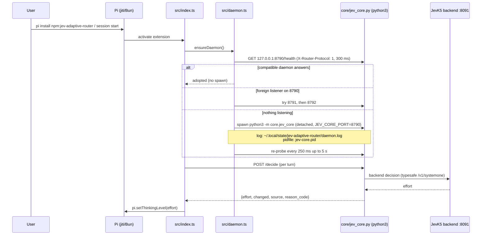

# pi-jev-thinking-router — Pi/omp package

Self-contained adaptive thinking-effort routing for the Pi coding agent (and
the omp fork). The npm package embeds the jev-router core daemon (vendored
stdlib-only Python under `core/`) and manages its lifecycle like an LSP
server: `pi install npm:pi-jev-thinking-router` is all a user needs — no external
infrastructure, no manual daemon.

SPI v1, effort-only: before each agent turn the extension asks the local
daemon (`POST /decide`) which thinking level fits the task and applies
`pi.setThinkingLevel()`. The model is never changed. Routing is **fail-open**:
any failure keeps the current thinking level; a turn is never broken.

## Layout

```text
adapters/pi/
├── package.json          pi.* + omp.* manifests, raw .ts (no build step)
├── src/index.ts          extension entry: /route, widget, hooks, daemon bootstrap
├── src/client.ts         SPI v1 HTTP client (fail-open)
├── src/daemon.ts         port probe + spawn lifecycle for the embedded core
├── src/*.test.ts         node --test suites (no python, no network)
├── core/                 VENDORED build artifact — scripts/sync-core.sh
└── skills/jev-router/SKILL.md   model-facing usage/diagnostics
```

`core/` is generated, not edited. Refresh it after any change in
`/workspace/jev-routing/core/`:

```bash
scripts/sync-core.sh            # from the repo root (or anywhere)
```

## Install

Target (after `npm publish`):

```bash
pi install npm:pi-jev-thinking-router
```

Today (local path — loaded from the resolved path, no copy):

```bash
pi install ./adapters/pi                 # persistent, writes ~/.pi settings
pi -e ./adapters/pi/src/index.ts         # one-off session
```

omp loads the same package through the `omp.extensions` manifest; the bundled
`skills/jev-router/SKILL.md` is discovered by both hosts (one level deep).

## How it starts (LSP pattern)



Failure anywhere in the chain => degraded mode: status bar shows
`⚡ fallback`, `/decide` is skipped or fails open, thinking stays manual.

## Configuration

Extension (read at startup):

| Var | Default |
|---|---|
| `JEVRROUTER_URL` | unset — when set, points at an EXTERNAL daemon and disables probe/spawn |
| `JEVRROUTER_TIMEOUT_MS` | `3000` |
| `JEVRROUTER_ENABLED` | `1` (`0` = extension inert) |
| `JEVRROUTER_NOTIFY` | `1` |
| `JEVRROUTER_CAP` | unset |
| `JEVRROUTER_DEFAULT_EFFORT` | `medium` |
| `JEVRROUTER_UI_DEFAULT` | `on` |
| `JEVRROUTER_PYTHON` | `python3` |

Embedded daemon — set as `JEVRROUTER_<SUFFIX>` or `JEV_<SUFFIX>`
(`JEVRROUTER_` wins); forwarded to the spawned process:

| Var | Default |
|---|---|
| `JEV_KIND` | `typesafe` |
| `JEV_API_URL` | `http://localhost:8091/v1` |
| `JEV_MODEL` | `jevk5-0.2` |
| `JEV_CORE_PORT` | `8790` (probe window: 8790, 8791, 8792) |
| `JEV_TIMEOUT_MS` | `3000` |
| `JEV_HOME` | state dir (`$XDG_STATE_HOME/jev-adaptive-router` or `~/.local/state/jev-adaptive-router`) |
| `JEV_API_KEY` | unset — forwarded to the daemon, never logged, never in `/health` |

Slash commands: `/route on|off`, `/route status`, `/route last`,
`/route show on|off` (per-session), legacy `/router`. See
`skills/jev-router/SKILL.md` for the model-facing reference.

## Tests

```bash
cd adapters/pi
node --test src/route.test.ts src/daemon.test.ts   # 34 tests, no python, no network
```

The daemon suite injects probe/spawn/pidAlive/sleep fakes; the route suite
stubs `fetch` and always sets `JEVRROUTER_URL` (external mode => no spawn).

## Troubleshooting

**Port 8790 held by something else.** Expected and handled: the daemon moves to
8791, then 8792. `/route status` shows the actual URL + `daemon: spawned pid N
@ ...`. If all three are foreign, status shows `UNAVAILABLE — no free port`.

**`python not found`.** The spawn failed with ENOENT. Install python3 or point
`JEVRROUTER_PYTHON` at an interpreter (absolute path works). The message is
surfaced in `/route status`; there is no retry storm (one attempt per
activation).

**`core unavailable` / `fallback` in the status bar (degraded).** Routing stays fail-open. Check:

```bash
curl -s -H 'X-Router-Protocol: 1' http://127.0.0.1:8790/health
cat ~/.local/state/jev-adaptive-router/jev-core.pid    # "<pid> <port>"
tail -n 50 ~/.local/state/jev-adaptive-router/daemon.log
```

If the pidfile's pid is dead, remove the pidfile and restart the session (live
pidfile + answering port is auto-adopted; a dead one is overwritten on spawn).

**Vendored core missing.** `core/` is gitignored; run `scripts/sync-core.sh`
before local-path installs from a fresh clone.

**Backend (`:8091`) down.** The daemon still answers `/health` (warmup
`failed:...`) and `/decide` returns keep-decisions (`no_backend`/`jev_error`)
— effort is never escalated. That is fail-open working as designed.
